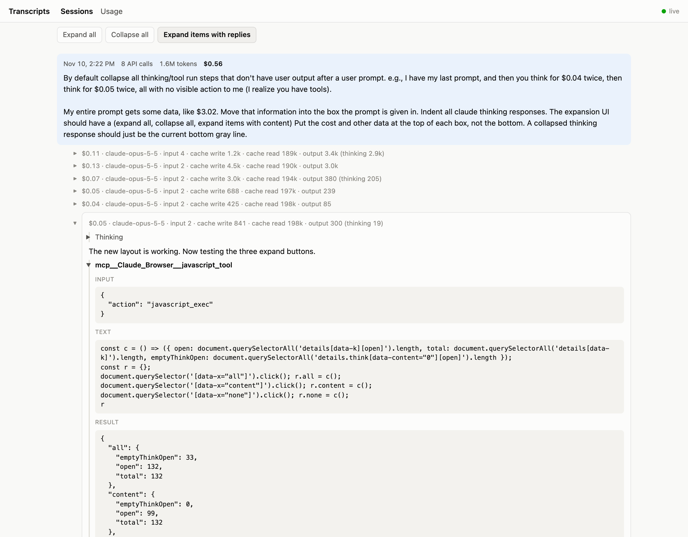
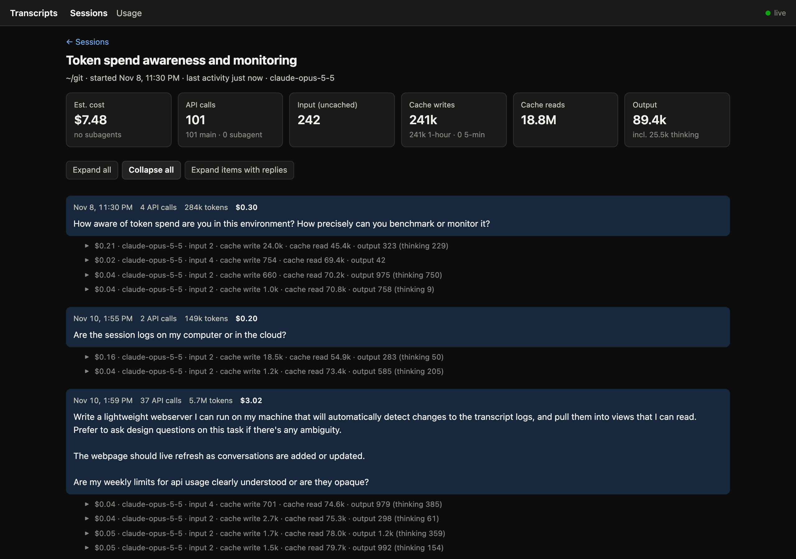
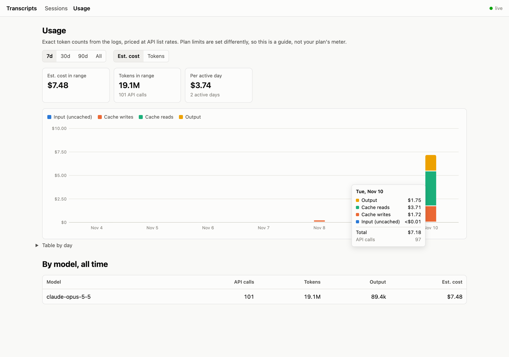
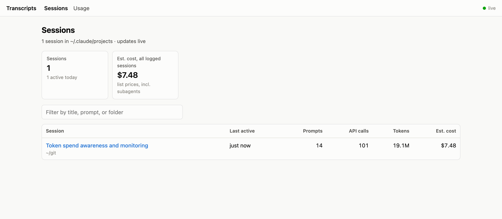

# transcript-viewer

A small local web app for reading Claude Code session transcripts (`~/.claude/projects/**/*.jsonl`) and
seeing where the tokens went. Pages update live as sessions are written.

```bash
node server.js            # http://127.0.0.1:4777
```

No dependencies (Node 18+). It only listens on 127.0.0.1.

## Screenshots

The session that built this tool, as the viewer shows it.

**Reader.** Each prompt box shows that turn's time, API calls, tokens and cost. Steps with no visible
reply collapse to one line with their cost and tokens; this one is open to show a tool call.



**Reader, everything collapsed** (dark theme).



**Usage.** Estimated cost or tokens per day, split by category.



**Sessions.**



## Views

- **Sessions**: every session, most recent first: title, folder, prompts, API calls, tokens, estimated cost.
- **Session**: the conversation, split into turns. Tool calls, thinking and subagent conversations are
  collapsed. Each API call shows its tokens (input, cache write, cache read, output, thinking) and cost.
- **Usage**: tokens or estimated cost per day, split by category, plus totals by model.

## Settings (environment variables)

| Variable | Default | Meaning |
|---|---|---|
| `PORT` | `4777` | HTTP port |
| `HOST` | `127.0.0.1` | Address to listen on |
| `CLAUDE_PROJECTS_DIR` | `~/.claude/projects` | Folder of transcripts to read |
| `WEEKLY_RESET_AT` | unset | Any past or future weekly-limit reset time (ISO 8601, e.g. `2026-11-12T01:00:00Z`). When set, the Usage page shows totals for the current weekly window. |

## How the numbers are calculated

- Claude Code writes one API response over several lines that repeat the same `usage`. The viewer
  counts each `message.id` once.
- Costs use the list prices in `pricing.json`. The Opus 5.5 figures match the cost Claude Code itself logs.
  Prices marked `"assumed": true` are guesses; costs that use them show a `~`.
- Thinking text is usually empty in the logs (the API leaves it out by default). Its token count is still logged.
- The cost is what this usage would cost at API list prices. Your subscription plan's limits are measured
  differently, so treat these numbers as a guide.

## How it works

`server.js` reads each transcript once, then reads only the lines appended since. It watches the folder
with `fs.watch` (and rescans every 5 s in case an event is missed). It tells open pages what changed over
server-sent events (`/events`), and each page reloads only the data it shows.
